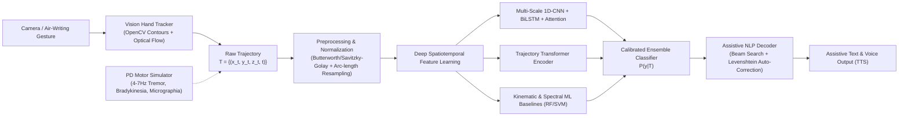
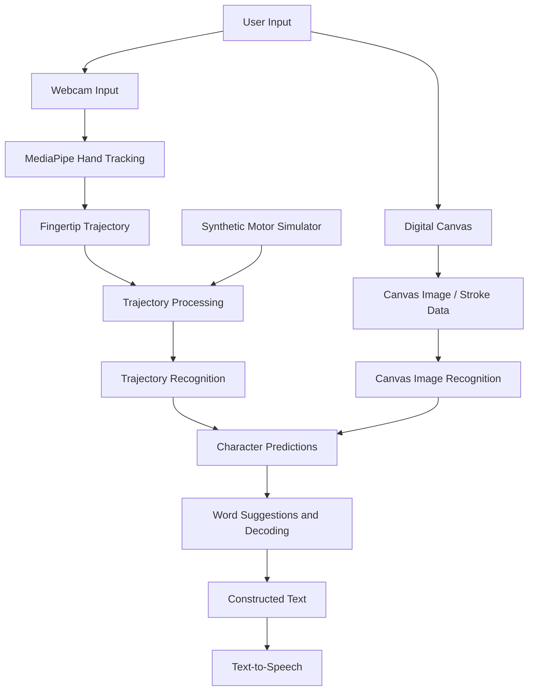

# Contactless Air-Writing Recognition for Assistive Communication in Parkinson’s Disease

[](https://www.python.org/)
[](https://pytorch.org/)
[]()

A deep learning framework for **contactless air-writing recognition** designed to decode intentional text from tremor-affected, irregular, and impaired 3D/2D hand trajectories in individuals with **Parkinson's Disease (PD)**.

---

## 1. System Architecture



---

# AirAssist: Contactless Air-Writing Recognition System

AirAssist is a Python-based air-writing application that explores contactless character recognition and assistive text interaction using hand movements captured through a webcam or drawn on a digital canvas.

The project combines computer vision, trajectory processing, deep learning, simulated motor impairments, and word-level text assistance in an interactive web application.

> **Project scope:** This is an experimental software prototype. Its impairment simulation uses synthetically generated trajectories. It has not been clinically validated and is not intended for Parkinson's disease diagnosis or medical decision-making.

---

## Features

### 1. Air-Writing Canvas
- Draw letters, numbers, and words using an interactive digital canvas.
- Submit drawn input for character recognition.
- Build text using recognized characters.
- Edit the generated text using space, backspace, and clear controls.

### 2. Webcam-Based Hand Tracking
- Uses MediaPipe Hands to detect hand landmarks.
- Tracks the index fingertip for air-writing interaction.
- Supports gesture states such as drawing, pen lift, and clearing the canvas.
- Uses OpenCV for image and webcam-frame processing.

### 3. Character Recognition
The project includes trajectory-based recognition models:

- **Multi-scale 1D CNN + BiLSTM:** Learns spatial and sequential patterns in writing trajectories.
- **Trajectory Transformer:** Uses self-attention to process trajectory sequences.
- **Random Forest and SVM:** Classical machine-learning baselines using engineered trajectory features.

The recognition pipeline includes trajectory filtering, normalization, resampling, and classification.

### 4. Synthetic Motor-Impairment Simulator
The simulator generates modified writing trajectories for four experimental settings:

- Control
- Mild
- Moderate
- Severe

The synthetic transformations include:
- Tremor-like oscillations
- Movement slowing and hesitation
- Progressive trajectory shrinkage
- Overshoot and trajectory noise

These are simulated movement effects, not measurements from people with Parkinson's disease.

### 5. Assistive Word Suggestions
- Beam-search decoding of character prediction sequences.
- Vocabulary-based word suggestions.
- Levenshtein-distance-based spelling correction.
- Prefix-based autocomplete.
- An assistive vocabulary containing everyday and care-related expressions.

### 6. Text-to-Speech
The web interface includes a Speak control for reading constructed text aloud using browser speech functionality.

### 7. Movement Feature Analysis
The project extracts trajectory characteristics such as:
- Mean and maximum movement speed
- Acceleration and jerk
- Curvature
- Path length and efficiency
- Tremor-band frequency features
- Geometric trajectory measurements

These are software-derived movement features, not clinically validated biomarkers.

---

## Technology Stack

| Area | Technologies |
|---|---|
| Programming language | Python |
| Deep learning | PyTorch |
| Machine learning | Scikit-learn |
| Computer vision | OpenCV |
| Hand tracking | MediaPipe Hands |
| Numerical processing | NumPy, SciPy |
| Web application | Flask, HTML, CSS, JavaScript |
| Text assistance | Beam search, Levenshtein distance |
| Speech output | Browser Text-to-Speech |

---

## Recognition Classes

The character template module defines 36 recognition classes:

- Digits: `0–9`
- Uppercase letters: `A–Z`

The trajectory models are configured to process three-channel input sequences, with the standard trajectory representation using 64 sampled points.

---

## Project Architecture



The application contains both canvas-image recognition and trajectory-based recognition paths. The canvas prediction endpoint attempts the image-based recognizer first and uses trajectory recognition as a fallback when applicable.

---

## Getting Started

### 1. Clone the repository

```bash
git clone https://github.com/M-Nivetha7/parkinson_research1.git
cd parkinson_research1
```

### 2. Create a virtual environment

```bash
python3 -m venv .venv
```

Activate it:

**macOS / Linux**
```bash
source .venv/bin/activate
```

**Windows**
```bash
.venv\Scripts\activate
```

### 3. Install dependencies

The repository currently does not provide a root-level `requirements.txt`. Install the packages required by the application:

```bash
python -m pip install numpy scipy flask opencv-python torch scikit-learn
```

For webcam hand tracking, install MediaPipe if it is supported by your Python version and operating system:

```bash
python -m pip install mediapipe
```

### 4. Start the web application

```bash
python -m app.web_app
```

Open the following address in your browser:

```text
http://localhost:5050
```

The application uses port `5050` by default. A different port can be supplied through the `PORT` environment variable or the application's command-line argument.

---

## Model Checkpoints

The web application looks for trained model checkpoints in the `saved_models/` directory.

The trajectory recognition components use these checkpoint filenames:

```text
saved_models/
├── conv1d_bilstm.pt
├── transformer.pt
└── baseline_rf.pkl
```

These files are generated or loaded by the project's model-training workflow.

If trained checkpoints are unavailable, the application may initialize models without trained weights. A running interface should not be interpreted as evidence of accurate recognition.

---

## Training

The repository includes a training script:

```bash
python train.py --model all --epochs 25 --samples_per_class 45
```

Supported model selections include:

```text
conv1d_bilstm
transformer
baseline_rf
baseline_svm
all
```

Training uses synthetically generated air-writing trajectories.

---

## API Endpoints

The Flask application defines the following endpoints:

| Method | Endpoint | Purpose |
|---|---|---|
| GET | `/` | Loads the web interface |
| POST | `/api/predict` | Predicts characters from canvas image data or trajectory input |
| POST | `/api/simulate` | Generates a synthetic trajectory and returns prediction information |
| POST | `/api/decode_word` | Generates word suggestions from character probabilities or a text prefix |
| POST | `/api/process_frame` | Processes a webcam frame for hand tracking |

The webcam endpoint requires MediaPipe to be installed.

---

## Limitations

- The motor-impairment simulator generates synthetic trajectories.
- Real-world performance with people experiencing motor impairments has not been established.
- Recognition quality depends on the availability and suitability of trained model checkpoints.
- Canvas-image recognition and trajectory recognition use different processing paths.
- Webcam tracking depends on camera quality, lighting, hand visibility, and landmark detection.
- Vocabulary-based correction can suggest an incorrect word, particularly for words outside its vocabulary.
- The project is an experimental prototype, not a production-ready medical device.

---

## Responsible Use

AirAssist is developed for software experimentation and assistive-technology exploration.

The simulated impairment categories are algorithmic settings, not clinical severity assessments. The application must not be used to diagnose Parkinson's disease, estimate an individual's clinical condition, or replace professional medical advice.

No claim of clinical effectiveness or real-patient validation is made.

---

## License

No license file is currently included in this repository. All rights remain with the respective copyright holders. Contact the repository owner before redistributing or reusing the project.

---

## Author

**Nivetha Mayilvaganan**

GitHub: https://github.com/M-Nivetha7

Project repository: https://github.com/M-Nivetha7/parkinson_research1
